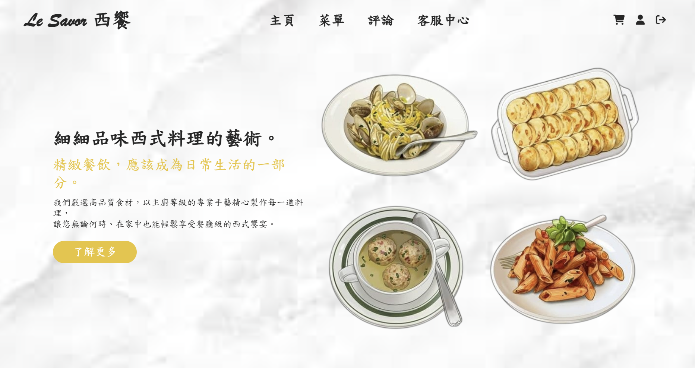

# 🍝 West Food Restaurant

一個提供使用者登入、商品瀏覽與管理功能的餐廳網站，  
具備登入功能、角色權限與後台管理概念。


## 首頁畫面




## 功能介紹

- 使用者註冊 / 登入
- 密碼加密儲存（bcrypt）
- Navbar 依登入狀態切換
- 商品分類瀏覽
- 顧客評論
- 管理者後台
    - 使用者管理
    - 資料管理
    - 數據監測


## 使用技術

### Frontend
- Vue 3
- Pinia
- Vue Router
- Axios

### Backend
- Java 17
- Spring Boot 3
- MongoDB
- bcrypt

### Other
- Docker
- Render Deployment

## 專案說明

- 本專案使用 `concurrently` 同時啟動前端與 Java 後端
- 後端使用 `bcrypt` 對使用者密碼進行雜湊處理，不以明文方式儲存


## 專案啟動方式

### 1. Clone 專案
```bash
git clone https://github.com/Clare0808/SAD-west-food-restaurant.git
```

### 2. 安裝套件

```bash
npm install
cd backend && mvn test
```

### 3. 環境需求

- Node.js
- npm
- JDK 17
- Maven 3.9+
- MongoDB

### 4. 環境變數設定

本機執行 `npm run start` / `npm run backend` 會從 `backend/.env` 載入環境變數

直接執行 `mvn spring-boot:run` 或部署到 Render 時則須設定系統環境變數：

```env
PORT=3000
MONGO_URL=mongodb://127.0.0.1:27017/west_food
JWT_SECRET=yourSecretKey
GOOGLE_CLIENT_ID=yourGoogleClientId
GOOGLE_CLIENT_SECRET=yourGoogleClientSecret
GOOGLE_CALLBACK_URL=http://localhost:3000/api/auth-callback
FRONTEND_URL=http://localhost:8080
MENU_DATA_DIR=../public
MENU_SEED_DIR=../public
```

### 5. 啟動專案

```bash
npm run start
```

從專案根目錄執行此指令會使用本機的 MongoDB (`127.0.0.1:27017`)

`npm run start` 透過本機啟動器呼叫 Maven，需安裝 JDK 17 / Maven 3.9+。

若要分開啟動 (選擇性) :

#### 前端

```bash
npm run serve
```

#### 後端
```bash
cd backend
mvn spring-boot:run
```

### 本地 Docker Compose

在專案根目錄設定環境變數 `JWT_SECRET`，
啟動 Docker Desktop，執行 :

```bash
docker compose up --build
```
若有修改前端須重新執行。

開啟 `http://localhost:8080`。

欲停止則執行 : 

```bash
docker compose down
```

Docker 模式與開發模式都使用 8080，請勿同時佔用該埠。
